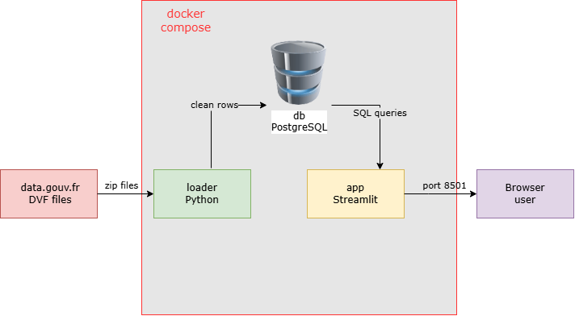

# France Housing Prices
In which French cities has the price per m² risen the most between 2022 and 2025?

## Author
Nicolas Grimaldi, individual project (non-attending student)

## How to run
1. Install Docker Desktop
2. Get the code by doing: `git clone https://github.com/Nicolasgrimaldi2011/france-housing-prices.git`
3. Get into the file by doing: `cd france-housing-prices`
4. Create the .env file by using the .env example from Github:
    - if you are on Windows it's: `copy .env.example .env`
    - if you are on Mac or Linux it's: `cp .env.example .env`
5. Run: `docker compose up`
    - This is to start the whole system (Docker Desktop must be running)
    - The command creates the images and starts the three containers in the right order
    - The first start downloads the 4 DVF files from data.gouv.fr (about 300 MB) and loads them into the database. It takes about 5 minutes.
6. Once the containers are running, open your web browser and go to http://localhost:8501 to see the dashboard. 

## Data
**Source:** "Demandes de valeurs foncières" (DVF), published by the French tax administration (DGFiP) on the official French open data portal data.gouv.fr: https://www.data.gouv.fr/datasets/demandes-de-valeurs-foncieres/
(last update used: October 2026)

**Content:** It lists all the property sales in France. Each row is one part of a sale (for example a flat, or the cellar sold with it), with the date, the price, the town, the type of property and the surface. I use 4 years, from 2022 to 2025. There is one zip file per year, around 60-85 MB each (about 450-600 MB each once unzipped). In total, there are almost 16 million rows.

**Licence:** The data is under the Licence Ouverte 2.0: it can be used, modified and shared freely, as long as the source and the date of the last update are mentioned. Because the sales could be linked to real people, it is forbidden to try to identify them. This project only shows results per town (median prices), never single sales.

**Format:** text files separated by `|`. Prices use a comma as decimal separator (`468000,00`) and dates are written `DD/MM/YYYY`.

**Download:** the data files are not in this repository. The loader downloads them automatically from the stable URLs of data.gouv.fr when it starts, unzips them into the `data/` folder, and skips this step if the files are already there.

## Architecture

- **db**: PostgreSQL database, stores the sales
- **loader**: downloads the DVF files, cleans them and puts them in the database, then stops
- **app**: Streamlit dashboard, reads the database and shows the results

## Measurements

## What went wrong
